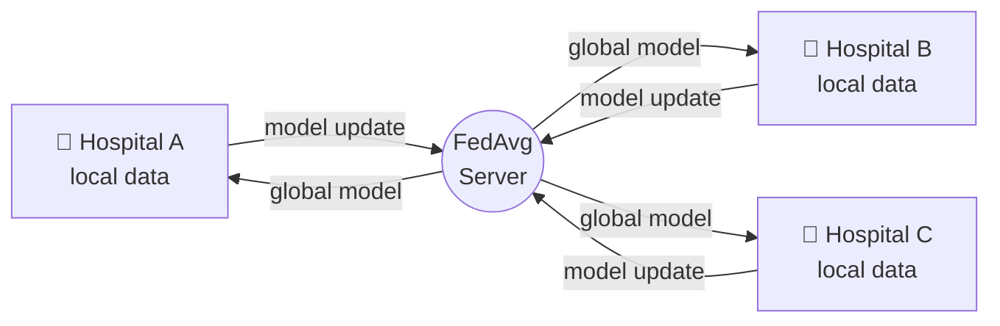

<div align="center">

# ✦ HEALTHGRID AI ✦

### Privacy-Preserving Federated Machine Learning for Healthcare

*Hospitals learn together. Patient data never leaves home.*

<br/>


<br/>

**KDK College of Engineering, Nagpur** &nbsp;·&nbsp; Dept. of AI & Data Science
First Project Title Seminar

</div>

---

## ◆ Overview

Healthcare data is scattered across hospitals and holds some of the most sensitive information there is. Pooling it into one central database creates privacy, security and data-sharing risks.

**HealthGrid AI** takes the opposite approach. Instead of moving data to the model, it moves the model to the data.

1. Each hospital trains a model **locally** on its own records.
2. Only the learned **model update** is sent to a federated server.
3. The server combines the updates with **Federated Averaging (FedAvg)** into a stronger global model.
4. The global model returns to every hospital for the next round.

> **Raw patient records never leave the hospital.**

This prototype runs entirely in the browser on **synthetic data** for three simulated hospitals. No backend, no real patient information.

---

## ◆ How It Works



| Step | What happens |
|:--|:--|
| **01 · Local training** | Each hospital trains logistic regression with mini-batch SGD on its own data. |
| **02 · Send update** | Only the model weights travel to the server, never patient records. |
| **03 · Aggregate** | The server averages updates, weighted by each hospital's record count. |
| **04 · Redistribute** | The improved global model is sent back, then the next round begins. |

On the default settings the global model climbs from about **47%** accuracy at round 0 to about **79%** on held-out records.

---

## ◆ Features

| Page | Purpose |
|:--|:--|
| **Home** | Project story, objectives, methodology, roadmap, literature survey, team, and a Login button |
| **Dashboard** | Global accuracy, training progress, live learning flow, training log |
| **Hospitals / Clients** | Status, dataset size and details for Hospital A, B and C |
| **Federated Training** | Start, pause, step and reset rounds with per-hospital progress |
| **Model Performance** | Accuracy and loss charts for the global model and each hospital |
| **Dataset** | Synthetic datasets, data profile rings and bars, regenerate on demand |
| **Logs & Privacy** | Activity log, what is shared, active and planned privacy techniques |
| **Settings** | Local epochs, learning rate and total rounds |
| **Predictions** | Adjust patient values and read the risk estimated by the global model |
| **About the Project** | Abstract, problem statement, objectives, methodology, literature |

**Design:** a dark and gold luxury theme with an animated background, scroll reveals, and a sliding-icon button style.

---

## ◆ Quick Start

Requires [Bun](https://bun.sh). Node.js works too.

```bash
git clone https://github.com/devanshupatil/HealthGrid-AI.git
cd HealthGrid-AI/FrountEnd

bun install
bun run dev        # development server
bun run build      # production build → dist/
bun run preview    # preview the build
```

Open the home page, press **Login**, enter any username and password, and start training from the dashboard.

---

## ◆ Project Structure

```text
FrountEnd/
├── index.html
├── tailwind.config.js          Theme tokens: colours, fonts, spacing
└── src/
    ├── App.jsx                 Login gate, page routing, shared training state
    ├── fl/
    │   ├── engine.js           Synthetic data, logistic regression, FedAvg
    │   └── useFederation.js    Training rounds as a React hook
    ├── pages/                  Home, Hospitals, Training, Performance,
    │                           Dataset, Logs, Settings, Predictions, Project
    ├── components/             Sidebar, TopBar, charts, illustrations
    │   └── ui/                 Button, button-with-icon, logout-button
    └── lib/utils.js
```

---

## ◆ Privacy Techniques

| Technique | Status |
|:--|:--:|
| Local training, data stays at each hospital | ✅ Active |
| Federated Averaging (FedAvg) | ✅ Active |
| Secure aggregation | 🕓 Planned |
| Differential privacy | 🕓 Planned |
| Authorized EHR / API integration | 🕓 Planned |

---

## ◆ Roadmap

- [x] Working prototype with three simulated hospital clients
- [x] Multiple FedAvg rounds with performance comparison
- [x] Dashboard for training status, performance and predictions
- [ ] Study how different hospital data distributions affect the global model
- [ ] Secure aggregation and differential privacy
- [ ] Authorized EHR / API integration for real-world deployment

---

## ◆ Notes

- **The login is a demo.** Any username and password works. Nothing is stored or sent, and a refresh returns you to the home page.
- **Predictions are not medical advice.** They come from synthetic data and exist only to demonstrate the model.

---

## ◆ Research Foundation

| Author | Year | Work |
|:--|:--:|:--|
| H. B. McMahan | 2017 | *Communication-Efficient Learning of Deep Networks from Decentralized Data* |
| T. S. Brisimi | 2018 | *Federated Learning of Predictive Models from Federated Electronic Health Records* |
| N. Rieke | 2020 | *The Future of Digital Health with Federated Learning* |
| M. J. Sheller | 2020 | *Federated Learning in Medicine: Facilitating Multi-Institutional Collaborations Without Sharing Patient Data* |
| P. Kairouz | 2021 | *Advances and Open Problems in Federated Learning* |

---

<div align="center">

## ◆ Team

**Aditya Rathod** · **Purushottam Ghatul** · **Shweta Supe** · **Shweta Patil**

Under the guidance of **Prof. Kartik Ingole**

<br/>

*KDK College of Engineering, Nagpur*

<sub>✦ HealthGrid AI · Academic prototype · Built with care for patient privacy ✦</sub>

</div>
